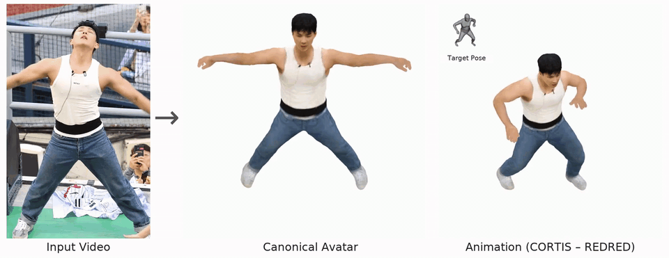

# [ECCV 2026] JacobianAvatar

[Project Page](https://wcy199705.github.io/JacobianAvatar/) | [Paper (ECCV)](https://link.springer.com/chapter/10.1007/978-3-032-37013-6_34) | [arXiv](https://arxiv.org/abs/2606.31115)



<h3 align="center">Official code of JacobianAvatar: Temporally Consistent Semi-rigid Avatar Reconstruction from a Monocular Video</h3>

## Quick Start

**Requirements:** Linux, NVIDIA GPU (24GB VRAM recommended; tested on RTX 3090).

> This repository contains **source code only**. External libraries, model weights, body models such as SMPL-X, and the MHR runtime environment (about 20GB)
> are not included for licensing and size reasons, so fetch them once with `scripts/usage/fetch_assets.sh` before your first run ([ASSETS.md](scripts/usage/ASSETS.md)).

```bash
# Setup) create the 3 conda environments (scripts/usage/INSTALL.md), then fetch weights and body models
bash scripts/usage/fetch_assets.sh          # external libraries (GitHub) + weights + body models. Requires SMPL-X/SMPLify accounts

# 0) Prepare the scene folder: /path/to/my_scene_training/images/00000.png ...  (+ K.npy, optional)
# 1) Write the scene configs
cp configs/legacy/SMPLX_dataloader/CUSTOM/template.yaml configs/legacy/SMPLX_dataloader/CUSTOM/my_scene.yaml
cp configs/datasets/Custom-template.yaml configs/datasets/Custom-my_scene.yaml
#    → edit the paths / scene name in both files

# 2) Preprocessing (7 steps + finalize)
bash scripts/usage/00_preprocess_custom.sh my_scene 2

# 3) Training (Pre → L0 → L1 → All → GS#1)
bash scripts/usage/01_train_custom.sh configs/datasets/Custom-my_scene.yaml 2

# 4) Visualization
bash scripts/usage/04_render_viz.sh configs/datasets/Custom-my_scene.yaml outputs/my_scene/viz 2 --mode canon
```

## Documentation

| Document | Contents |
|---|---|
| [scripts/usage/USAGE.md](scripts/usage/USAGE.md) | Full usage guide (data preparation → preprocessing → configuration → training → visualization) |
| [scripts/usage/INSTALL.md](scripts/usage/INSTALL.md) | Installing the 3 conda environments and dependencies |
| [scripts/usage/ASSETS.md](scripts/usage/ASSETS.md) | Fetching weights and body models (`fetch_assets.sh`), manual installation, verification (`check_assets.sh`) |
| [scripts/usage/README.md](scripts/usage/README.md) | List of run scripts |
| [docs/PIPELINE.md](docs/PIPELINE.md) | Training flow by stage |
| [docs/VISUALIZATION.md](docs/VISUALIZATION.md) | Rendering scripts in detail |
| [docs/DATASETS.md](docs/DATASETS.md) | Custom scene folder layout |

## License

The code in this repository is released under the [CC BY-NC 4.0](LICENSE) license (non-commercial use only).

**Commercial use is not permitted.** Parts of this code are derived from [Neural Jacobian Fields](https://github.com/ThibaultGROUEIX/NeuralJacobianFields),
which is released under the [Adobe Research License](third_party_licenses/NeuralJacobianFields/license.txt); this repository may therefore be used
for noncommercial research purposes (academic research and teaching) only.

Third-party code, libraries, weights and body models (SMPL-X / SMPL) keep their own licenses — see [third_party_licenses/](third_party_licenses/README.md)
and the table in [ASSETS.md](scripts/usage/ASSETS.md).

## Acknowledgements

Our implementation is built upon [Neural Jacobian Fields](https://github.com/ThibaultGROUEIX/NeuralJacobianFields) (Aigerman et al., SIGGRAPH 2022)
and [ExAvatar](https://github.com/mks0601/ExAvatar_RELEASE) (Moon et al., ECCV 2024).
We thank the authors for releasing their code.

## Citation

```bibtex
@inproceedings{jacobianavatar,
  title={JacobianAvatar: Temporally Consistent Semi-rigid Avatar Reconstruction from a Monocular Video},
  author={Won, Changyeon and Park, Min-Gyu and Park, Seonghwan and Yoon, Ju Hong and Jeon, Hae-Gon},
  booktitle={European Conference on Computer Vision},
  year={2026}
}
```
